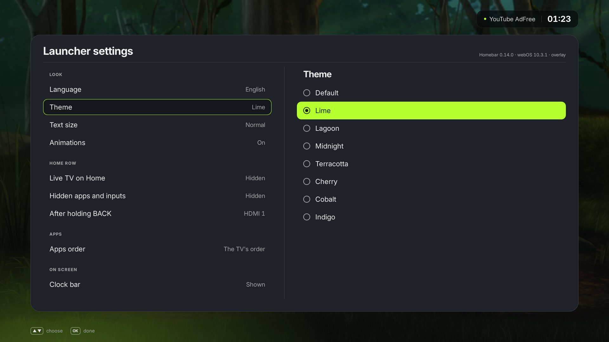
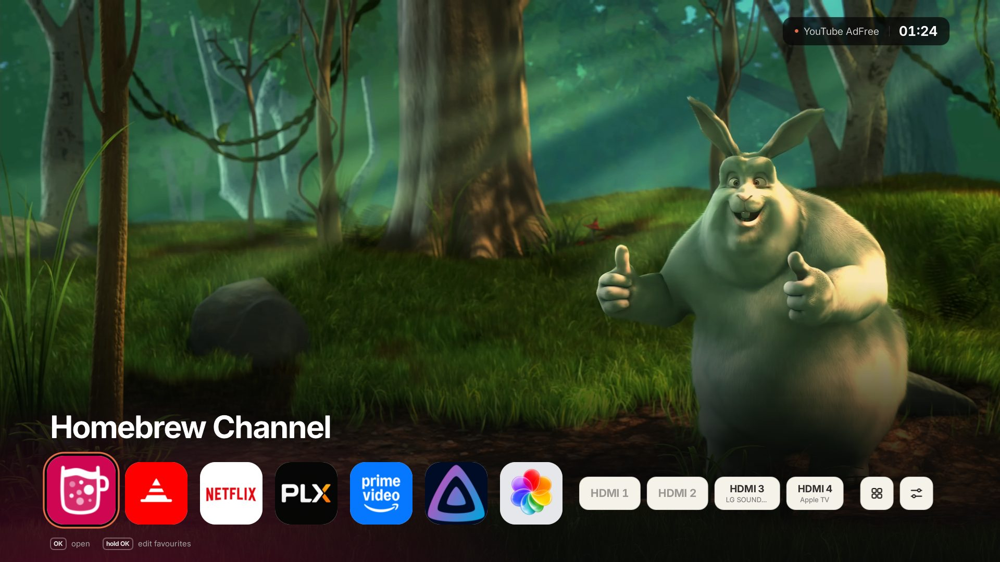

<h1 align="center">Homebar</h1>

<p align="center">
  <b>Your LG TV's home screen as a bar over the picture.</b><br>
  Not a full-screen menu that takes you out of what you were watching.
</p>

<p align="center">
  <a href="https://github.com/rawinek/webos-homebar/releases/latest"></a>
  
  <a href="LICENSE"></a>
</p>

<p align="center">
  <a href="https://buymeacoffee.com/rawin"></a>
</p>


Homebar is a home screen for rooted LG webOS TVs. Press HOME and a bar comes
up at the bottom of the screen, over whatever is playing: your favourite apps,
the TV's inputs with the device on each, all your apps and a System page.
The picture stays where it is. Press HOME again, or BACK, and it is gone.

## Highlights

<table>
  <tr>
    <td width="50%"></td>
    <td width="50%"></td>
  </tr>
  <tr>
    <td><b>Inputs by name.</b> Each HDMI input shows the device the TV sees on it, from HDMI-CEC; an empty one is dimmed. RED hides one you never use.</td>
    <td><b>Every app, one row away.</b> Twelve to a row on a 16:9 screen, in the TV's order, A to Z, or the most used first. LG's promotional apps are left out.</td>
  </tr>
  <tr>
    <td></td>
    <td></td>
  </tr>
  <tr>
    <td><b>Settings with a live preview.</b> One menu: language, theme, text size, the clock and the weather, what the row shows, backup and updates. Every value applies as you move to it.</td>
    <td><b>Favourites chosen on the TV.</b> Hold OK on an app to add it, up to seven; hold OK on a favourite to move it or take it off the row.</td>
  </tr>
  <tr>
    <td></td>
    <td></td>
  </tr>
  <tr>
    <td><b>Eight colour themes.</b> The original grey and seven two-colour themes, dark and light. <a href="docs/themes.md">See them all</a>.</td>
    <td><b>Readable from the sofa.</b> Three text sizes, a 24- or 12-hour clock, and a layout that fits HD as well as FHD and UHD screens.</td>
  </tr>
</table>

## What else it does

- **Nine languages**, the TV's own by default: English, Spanish, German,
  Polish, French, Italian, Portuguese, Dutch and Czech.
- **The weather** in the corner, next to the clock, from Open-Meteo with no
  account or key. The place is chosen on a phone, from a code on the TV.
- **Updates itself** from this repository's releases, in *Launcher settings
  → Updates*, with what is new in each; a dot on *System* says when one is
  there.
- **Backup and restore** of favourites and settings in one file.
- **webOS 10:** LG's own Home stays out of the way. A black stand-in takes
  its place, and the TV goes back to the last input (or a chosen one) when
  an app exits or BACK is held. Only a HOME in the first 40 s after a cold
  boot, before the Homebrew Channel's hooks run, opens LG's Home once.
- Nothing of LG's is uninstalled, and the TV's system partition is not
  written to. The uninstaller gives LG's Home back at once.

## Compatibility

| webOS (LG's name) | How Homebar runs | Status |
| :--- | :--- | :--- |
| 4.x (webOS 4.0 / 4.5, 2018–2019) | Inside LG's own Home, which keeps its HOME handling (the *Basic* Home screen, where a TV has two) | Tested on 4.10 (LG C9, and LG UM7100 by a user) |
| 5.x (webOS 5.0, 2020) | Inside LG's own Home, as on 4.x | Tested on 5.6 (LG NANO80, by a user) |
| 6.x (webOS 6.0, 2021) | The overlay, with LG's Home kept | Tested on 6.3 and 6.5 (LG C1 and LG UP78, by users) |
| 10.x (webOS 25, 2025) | A separate overlay app with a root helper | Tested on 10.3 (LG B4, and LG UR78 by a user) |
| 3.x, 7.x–9.x, 11.x (webOS 3, 22–24, 26) | Whichever of the two the TV has the makings for | Untested |

LG names webOS after the year since 2022 (webOS 25 is version 10.x, webOS 22
is 7.x), and an older TV can be updated to a newer webOS, so go by the
version the TV reports. `sh install.sh --probe` shows it, says which variant
fits, and changes nothing. Details in [Compatibility](docs/compatibility.md#webos-versions).

## Install

You need a rooted TV with the
[Homebrew Channel](https://github.com/webosbrew/webos-homebrew-channel) and a
root shell (SSH or telnet), and for the overlay variant (webOS 10, or a Home
that cannot take the panel) the **Input Hook** app from the Homebrew Channel.
Log in to the TV as root, then:

```sh
cd /tmp
curl -fL -o rawin-launcher.tar.gz https://github.com/rawinek/webos-homebar/releases/latest/download/rawin-launcher.tar.gz
rm -rf rawin-launcher && tar xzf rawin-launcher.tar.gz
sh rawin-launcher/install.sh
```

Press HOME on the remote when it is done. Options, installing without internet
on the TV, updating and uninstalling: [Install, update, uninstall](docs/install.md).

**Update:** *System → Launcher settings → Updates* (from 0.10.0 on).
**Uninstall:** `sh /var/lib/webosbrew/rawin-launcher/uninstall.sh` (Home panel)
or `sh /var/lib/webosbrew/rawin-launcher-home/uninstall.sh` (overlay).

Homebar was called **rawin-launcher** until 0.12.0. The release file and the
folders on the TV keep that name, so earlier installs update in place, and the
old GitHub address leads here.

## Documentation

- [Install, update, uninstall](docs/install.md)
- [Using the launcher](docs/using.md): favourites, hiding, System, every setting, backup, languages
- [Themes](docs/themes.md)
- [Compatibility](docs/compatibility.md)
- [How it works](docs/how-it-works.md): both variants, what is changed on the TV
- [Troubleshooting](docs/troubleshooting.md): `diagnose.sh`, getting LG's Home back
- [Development](docs/development.md): build from source, adding a language or a theme

Problems: run `diagnose.sh` (see [Troubleshooting](docs/troubleshooting.md#diagnose))
and attach its file to an [issue](https://github.com/rawinek/webos-homebar/issues).

## Support

I build free apps and tools and share them on GitHub. If you enjoy my
projects, you can support my work by
[buying me a coffee](https://buymeacoffee.com/rawin) ☕ (the code is also in
*Launcher settings → About Homebar* on the TV).

## Credits

- [webOS Homebrew Channel](https://github.com/webosbrew/webos-homebrew-channel)
  for root, `elevate-service` and the boot hooks, and Input Hook for the HOME
  button.
- [Glasshouse](https://github.com/rorygallagher2024/glasshouse) showed how the
  app manager re-reads LG's Home on webOS 10 (block and release of one app).
- [Inter](https://github.com/rsms/inter) typeface, SIL Open Font License 1.1.
- Video in the screenshots: *Big Buck Bunny* © Blender Foundation,
  [CC BY 3.0](https://creativecommons.org/licenses/by/3.0/).

## Disclaimer

Unofficial; not affiliated with or endorsed by LG Electronics. It runs as root
on your TV and replaces how its home screen works. Use at your own risk.

## License

MIT, see [LICENSE](LICENSE). The Inter font is under the SIL Open Font License
1.1 (`ui/fonts/OFL.txt`).
