# Themes

*System → Launcher settings → Theme* changes the launcher's colours. Each OK
moves to the next theme and the panel changes at once, so the setting itself
is the preview. The choice is saved with the other settings and kept by
updates.

There are eleven: **Default**, the launcher's original grey look, and ten
two-colour themes, four on a dark base and six on a light one.

## What the two colours do

Every theme other than Default is an **accent** and a **base**:

| | Where it shows |
| :--- | :--- |
| **Accent** | The focused tile's ring; the focused HDMI pill and System tile, filled; the dot in the clock bar; the glow in the bottom-left corner while an input, *Apps* or *System* is focused (an app keeps its own glow colour); the scroll bar in *Apps* |
| **Base** | The tiles, the HDMI pills and the System and settings tiles. On a light base they are light with dark text |
| **Shade** | Not chosen: always dark, a near-black of the base, under the name and the rail and behind the clock bar. The big name, the hints and the version over it stay white or light grey in every theme |

Text on the accent is white, or near-black when the accent is a light colour
(Lime, Meadow, Lagoon, Midnight). Warnings and the favourite you are moving
use amber in every theme.

The pictures below are the real panel, drawn on a computer with an HDMI input
focused (see [Development](development.md#theme-pictures)). The app icons are
stand-ins.

| Theme | Colours | Accent | Base |
| :--- | :---: | :--- | :--- |
| [Default](#default) |  | `#F2F3F5` | `#26282E` |
| [Lime](#lime) | 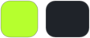 | `#B6FF2E` | `#1F2329` |
| [Meadow](#meadow) | 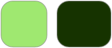 | `#9FE870` | `#163300` |
| [Lagoon](#lagoon) | 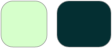 | `#D6FFCB` | `#042F32` |
| [Midnight](#midnight) | 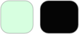 | `#D7FFE0` | `#050505` |
| [Sky](#sky) | 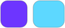 | `#6D35FF` | `#5DD8FF` |
| [Terracotta](#terracotta) |  | `#E26F4A` | `#FFFCF4` |
| [Cherry](#cherry) | 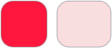 | `#FF173D` | `#F9DEDF` |
| [Cobalt](#cobalt) |  | `#1D61F3` | `#F1F4F9` |
| [Violet](#violet) | 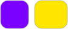 | `#7A00FF` | `#FFE600` |
| [Indigo](#indigo) |  | `#263BAA` | `#FFF4D6` |

## Default

The original look: grey tiles and pills, white focus, a neutral blue-grey glow.
Its accent and base above are the focused and the plain tile colours; Default
is spelled out colour by colour rather than made from two.

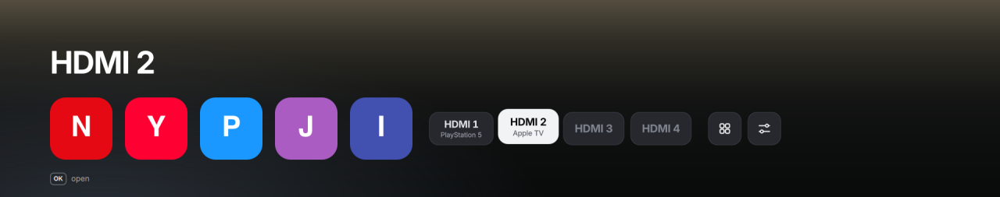

## Dark themes

Tiles in the base colour (Midnight's near-black base is lifted to a dark grey so
the tiles stand out from the shade), light text on them, the accent on what is
focused.

### Lime

 Accent `#B6FF2E` on graphite `#1F2329`.

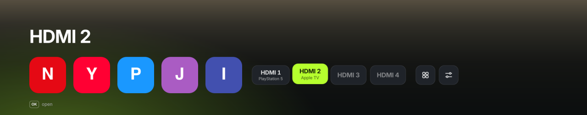

### Meadow

 Accent `#9FE870` on forest green `#163300`.

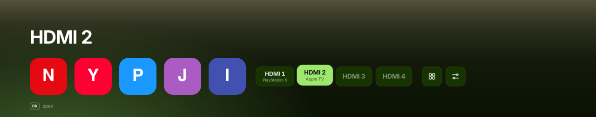

### Lagoon

 Accent `#D6FFCB` on deep teal `#042F32`.

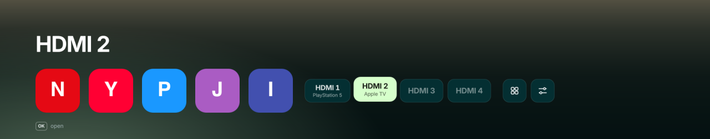

### Midnight

 Accent `#D7FFE0` on black `#050505`.

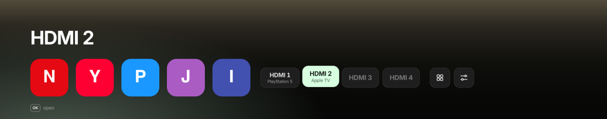

## Light themes

Light tiles and pills with dark text and icons, over the same dark shade as the
dark themes, so the name and the hints stay white over any picture.

### Sky

 Accent `#6D35FF` on sky blue `#5DD8FF`.

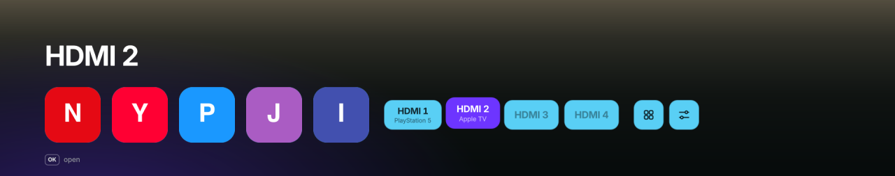

### Terracotta

 Accent `#E26F4A` on cream `#FFFCF4`.

### Cherry

 Accent `#FF173D` on blush `#F9DEDF`.

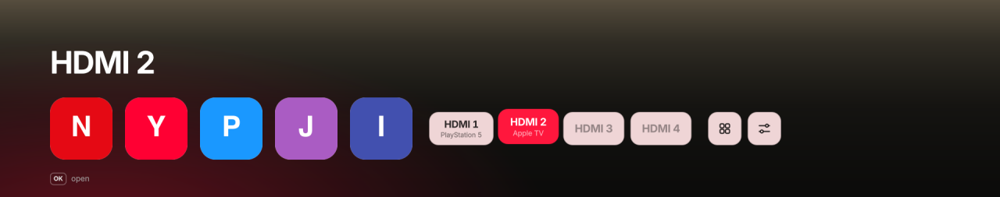

### Cobalt

 Accent `#1D61F3` on cool grey `#F1F4F9`.

### Violet

 Accent `#7A00FF` on yellow `#FFE600`.

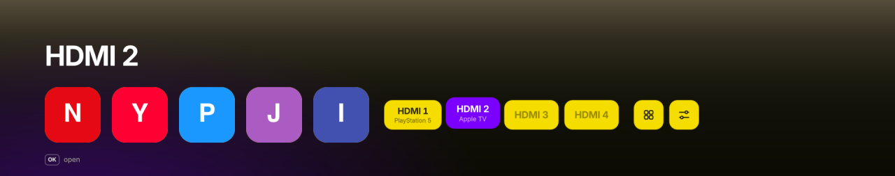

### Indigo

 Accent `#263BAA` on parchment `#FFF4D6`.

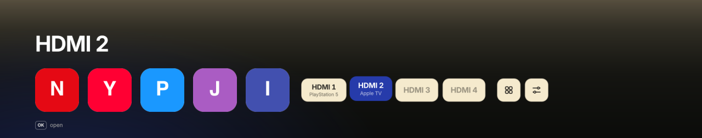

## Adding a theme

See [Development → Adding a theme](development.md#adding-a-theme).
