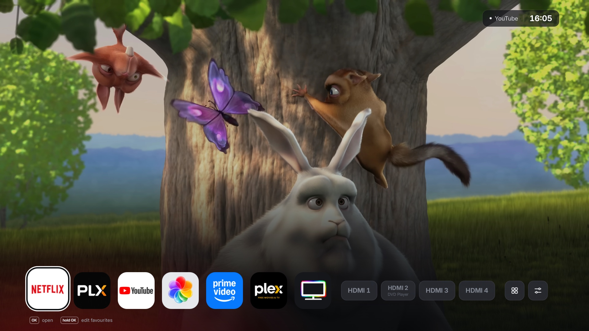
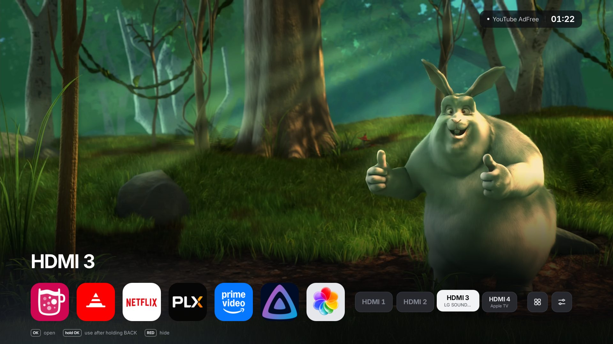
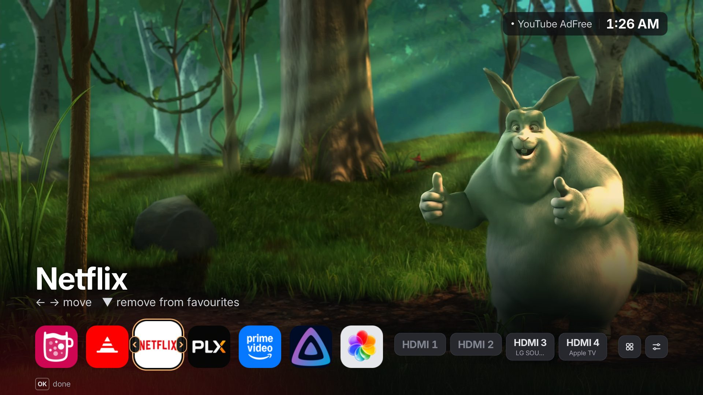
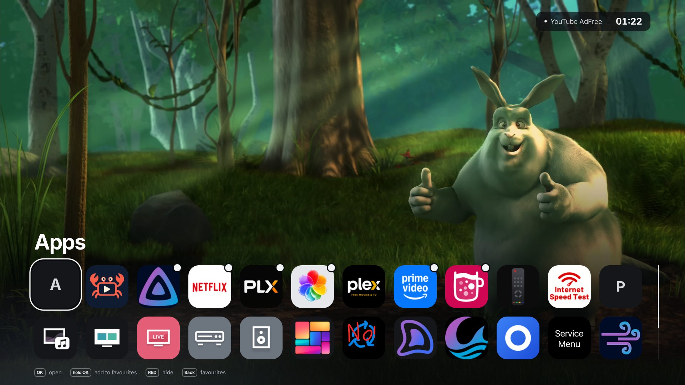
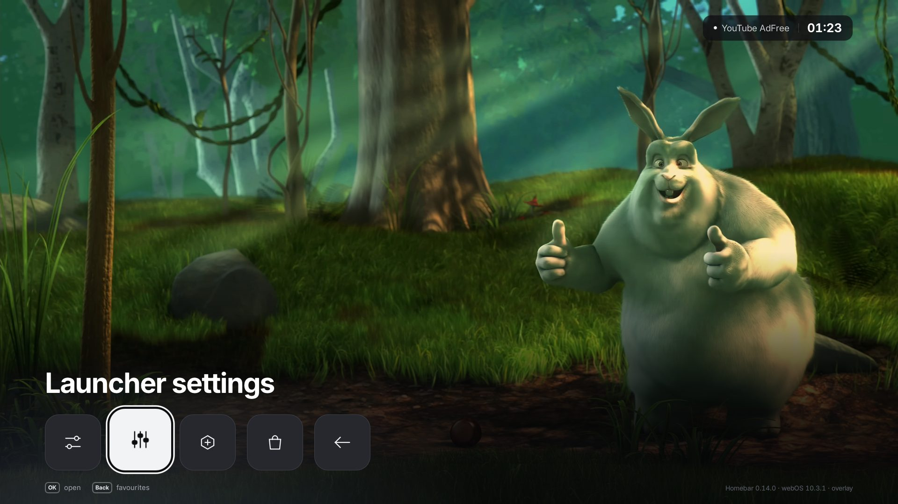
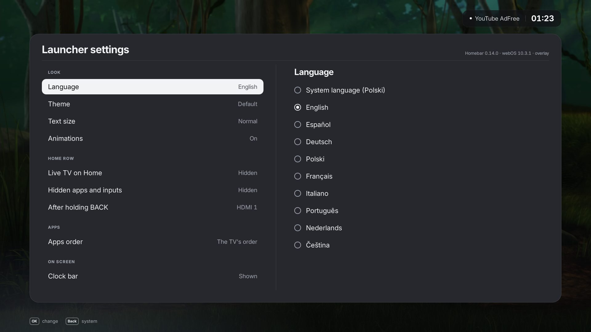
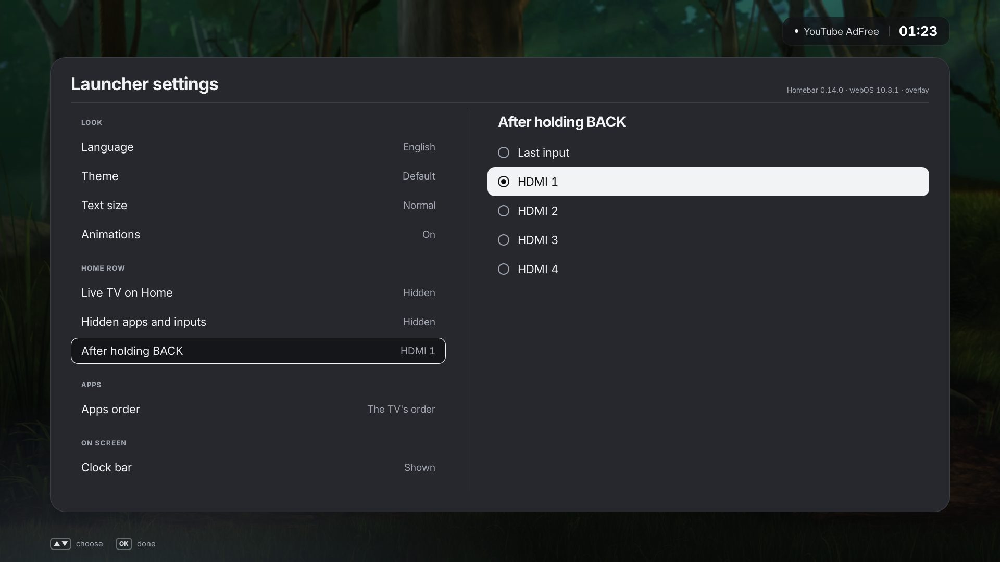
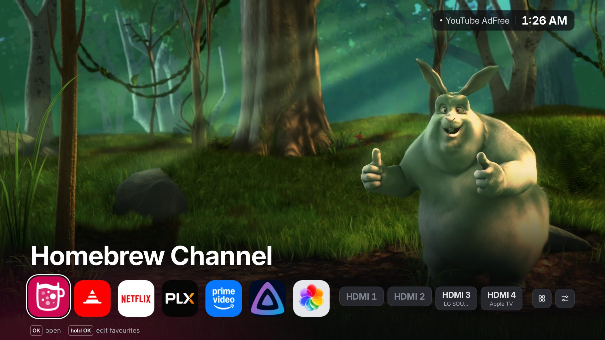
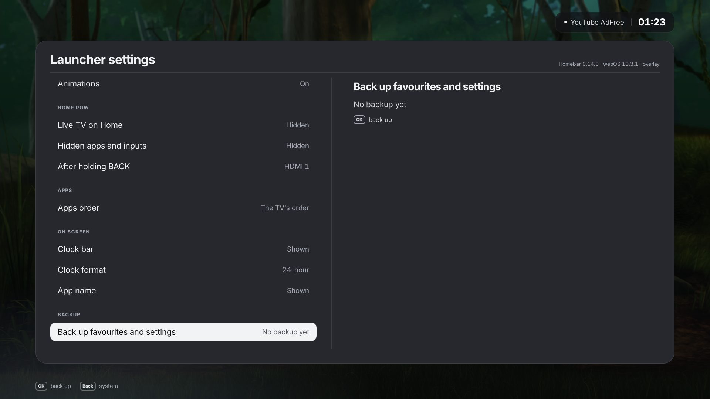

# Using the launcher

- [Home](#home)
- [Favourites](#favourites)
- [Hiding apps and inputs](#hiding-apps-and-inputs)
- [Apps](#apps)
- [System](#system)
- [Launcher settings](#launcher-settings)
- [Backup](#backup)
- [Languages](#languages)

## Home

HOME on the remote opens the panel over whatever is on screen; the picture
stays visible above it. One row, from the left:

- **Favourites**: up to seven apps. With none yet, an *Add favourites* tile
  opens *Apps*.
- **Sources**: *TV* (Live TV) when turned on in the settings, then the TV's
  inputs: HDMI, and DisplayPort or USB-C where a set has them, as many as
  the TV has. Each shows the device the TV sees on it: its HDMI-CEC name, or
  the input's own name when one is set on the TV. An input with nothing
  plugged in is dimmed. Long device names are cut to what the row has room
  for. RED hides an input you never use (see
  [Hiding apps and inputs](#hiding-apps-and-inputs)); on the overlay, hold
  OK on an input to make it where the TV goes after holding BACK.
- **Apps** and **System**. A dot on *System* means a new version of the
  launcher is there (see [Updates](#launcher-settings)).

The focused item's name shows above the row, and the hints under it say what
OK and the other keys do. The chip in the top-right corner shows what is on
screen, the [weather](#weather) and the time; each of the three can be hidden. BACK closes the panel; from *Apps* or *System* it goes
back to Home. The panel fits the TV's screen, HD or FHD/UHD, at the same
proportions. With the Magic Remote's pointer, a click on anything focuses
and opens it, and a click held does what holding OK does; pointing alone
changes nothing, and neither does the wheel. Holding OK also works with a
remote that sends it by infrared (a plain remote, or a Magic Remote without
its radio), which repeats a held key as quick presses.

LG's promotional apps (LG Channels, Sports, Alexa, …) are left out of the
launcher's lists. Nothing is uninstalled.

## Favourites

Favourites are chosen on the TV:

- In *Apps*, **hold OK** (or press YELLOW) on an app to add it, up to seven.
  A favourite is marked with a dot; holding OK on it again removes it.
- On Home, **hold OK** on a favourite to edit it: ← → move it, ▼ removes it,
  OK, BACK or ▲ finish.

A fresh install starts with none. Favourites outlast updates; an app that is
uninstalled simply drops out of them.

## Hiding apps and inputs

**RED** on an app in *Apps* hides it from the list (and drops it from the
favourites); RED on an input on Home hides it from the row. *Launcher
settings → Hidden apps and inputs → Shown dimmed* shows the hidden ones
again, dimmed, so RED on one can bring it back for good. Nothing is
uninstalled; hidden apps are only out of the launcher's lists.

## Apps

All installed apps, as many to a row as the screen is wide (twelve on a 16:9
screen), two rows on screen; the row scrolls with the focus. *Launcher
settings → Apps order* puts them in the TV's
order, from A to Z, or the most used first, counted from the launcher's own
launches. An app's glow colour lights the bottom-left corner while it is
focused: the colour the build knows for it, else one read from its icon.

## System

| Tile | Opens |
| :--- | :--- |
| TV settings | LG's settings app |
| Launcher settings | [Launcher settings](#launcher-settings) |
| PicCap | Only when installed |
| Homebrew Channel | |
| LG Content Store | |
| Original Home | LG's own Home: always with the Home panel; with the overlay only when LG's Home was kept (`--keep-lg-home`, or an untested webOS without `--replace-lg-home`) |
| Back to the picture | Closes the panel |

The launcher's version, the TV's webOS and the variant (Home panel or
overlay) are in the bottom-right corner.

## Launcher settings

*System → Launcher settings* opens a menu over most of the screen. On the
left are the settings in groups, each with its value; on the right the
values of the focused one, with a dot on the chosen value. ▲ ▼ move between
the settings; OK or ▶ goes into the values, where ▲ ▼ choose (each value
applies at once, so the menu itself is the preview) and OK or ◀ come back;
BACK closes the menu. *About Homebar*, first, shows the version and a code
to support the project. *Back up*, *Restore* and *Updates* show their status
on the right and act on OK; when a new version is found, *Updates* also
shows what changes in it, from its release notes. *Weather place* shows a
code to scan with a phone, see [Weather](#weather).

The values of *After holding BACK* (overlay), and Home with the text size
at *Larger* and the 12-hour clock:

| Group | Setting | Values |
| :--- | :--- | :--- |
| About | About Homebar | The version, a code to [buy me a coffee](https://buymeacoffee.com/rawin) and where the source is. The menu opens here |
| Look | Language | *System language* (the TV's menu language, when it is one of the [languages](#languages)), or one of them by hand |
| | Theme | Default or one of seven two-colour themes, see [Themes](themes.md) |
| | Text size | Normal, Large or Larger: the names, hints, labels and the menu grow; the tiles and pills keep their size, so the row still fits |
| | Animations | On or off |
| Home row | Live TV on Home | A *TV* pill before the inputs, shown or hidden |
| | Hidden apps and inputs | Hidden, or shown dimmed (to bring one back with RED) |
| | After holding BACK | Overlay only: the last input, or one of the TV's inputs. Also where the TV goes when an app exits |
| Apps | Apps order | The TV's order, A to Z, or the most used first |
| On screen | Clock | Shown or hidden |
| | Clock format | 24-hour (16:05) or 12-hour (4:05 PM); the backup's time follows it |
| | Current app | The app or input on screen, shown or hidden |
| | Weather | Shown or hidden, see [Weather](#weather) |
| | Weather place | The place of the weather; a code on the right opens a page on a phone to choose it |
| | Temperature | *Automatic* (°F when the TV's language is set for the United States, else °C), Celsius or Fahrenheit |
| | App name | Whether the big name of the focused item shows on Home and in *Apps* (System always shows it) |
| Backup | Back up favourites and settings | OK writes everything the launcher keeps to a file next to it; the status says when the last backup was made, see [Backup](#backup) |
| | Restore from the backup | OK brings that file back |
| Updates | Updates | The installed version; OK checks, downloads and installs a new release, see [Update](install.md#update). The launcher also looks once a day, the first time Home opens, and shows a dot on *System* and *Launcher settings* when a new version is there |
| | Test builds | Also offer pre-releases as updates |

Up to 0.14 one setting, *Clock bar*, showed or hid the whole chip. When it
was hidden, the clock, the app and the weather start hidden too.

## Weather

The chip at the top shows the weather now: a symbol and the temperature,
from [Open-Meteo](https://open-meteo.com), without an account or a key. It
is read each time Home opens and every quarter of an hour while it is up.

By default the place is the one the TV's internet address points to (from
[ip-api.com](https://ip-api.com)), which is often the nearest city of the
internet provider rather than your own. To choose it:

1. Open *System → Launcher settings → Weather place*. A code shows on the right.
2. Scan it with the phone's camera. The phone has to be on the same network
   as the TV.
3. On the page that opens, search for a town or city and tap it. The TV
   shows its weather within a few seconds.

*Use the TV's internet address instead* on the same page goes back to the
automatic place. The page's link works until the TV restarts (or the
launcher is updated); after that, scan the code again.

## Backup

*Back up favourites and settings* writes the favourites, the settings, the
hidden apps and inputs and the launch counts to `backup.json` next to the
installed launcher:
`/var/lib/webosbrew/rawin-launcher/backup.json` (Home panel) or
`/var/lib/webosbrew/rawin-launcher-home/backup.json` (overlay). *Restore
from the backup* brings it back; the file outlasts updates, and the
uninstaller removes it with the rest. From a computer,
`tools/deploy.py --host <tv-ip> --backup file.json` copies it over, and
`--restore file.json` puts a file on the TV for *Restore*.

## Languages

| Language | Code |
| :--- | :--- |
| English | `en` |
| Spanish (Español) | `es` |
| German (Deutsch) | `de` |
| Polish (Polski) | `pl` |
| French (Français) | `fr` |
| Italian (Italiano) | `it` |
| Portuguese (Português) | `pt` |
| Dutch (Nederlands) | `nl` |
| Czech (Čeština) | `cs` |

The launcher follows the TV's menu language when it is one of these, and falls
back to English otherwise. Corrections and new languages are welcome, see
[Development → Adding a language](development.md#adding-a-language).
